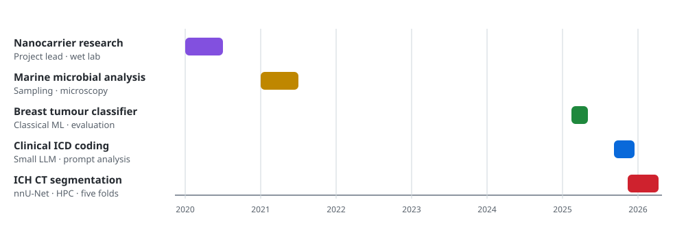

# Linpeng Yang | Medical AI & Health Data Science Portfolio

MSc Health Data Science graduate focused on medical imaging, clinical NLP,
machine-learning evaluation, and reproducible research. I turn research
questions into traceable workflows: data audit, model design, controlled
experiments, error analysis, and evidence-bounded reporting.

[中文版本](README.zh-CN.md)

## Profile snapshot

- **Target roles:** AI algorithm engineer · Medical AI · LLM applications
- **Core stack:** Python · PyTorch · scikit-learn · Transformers · nnU-Net
- **Research workflow:** Jupyter · Git · Linux · NCI Gadi · PBS
- **Strengths:** experiment design · cross-validation · error analysis ·
  reproducible reporting

## Project timeline

## Featured projects

| Project | Dataset | End-to-end work | Selected outcome |
|---|---|---|---|
| [Intracranial haemorrhage CT segmentation](projects/ich-segmentation.md) | **BHSD** head CT dataset, 192 aligned cases | Data governance → nnU-Net preprocessing → five-fold 2D/2.5D/3D training → OOF inference → paired and efficiency analysis | 3D native foreground Dice **0.307**; complete accuracy–recall–compute trade-off analysis |
| [Clinical ICD coding with a small language model](projects/icd-coding.md) | **Asclepius Synthetic Clinical Notes**, 158,114 records; 5 development and 10 test cases selected by the assignment | Dataset filtering → five prompt versions → structured parsing → decoding comparison → independent error analysis | Prompting constrained the output format but did not solve coding accuracy for Qwen2.5-0.5B |
| [Breast tumour classification](projects/breast-tumour-classification.md) | Course-provided **FNA Breast Cancer Tumour Dataset**, 580 records and Wisconsin-style morphology features | Data audit → label and duplicate cleaning → encoding/scaling → stratified split → GridSearchCV → held-out evaluation | **97.37%** accuracy and **0.93** malignant recall on 114 test records |
| [Marine microbial abundance analysis](projects/marine-microbial-analysis.md) | Field-collected seawater samples from different locations and sampling times | Sampling → plate counting → fluorescence microscopy → method comparison → environmental interpretation | Built a comparative experimental workflow linking abundance measurements with sampling conditions |
| [Stimuli-responsive marine-polysaccharide nanocarrier](projects/nanocarrier-research.md) | Project-generated formulation, cell-uptake, lysosomal-escape, stability, biosafety, and tumour-inhibition assay data | Project planning → carrier preparation → in-vitro validation → imaging and safety assessment → team reporting | Led the project and integrated multiple wet-lab validation streams |

## How I work

## Selected results

### ICH segmentation benchmark

| Method | Native foreground Dice | Whole-case wall median | Peak GPU allocation |
|---|---:|---:|---:|
| 2D nnU-Net | 0.2708 ± 0.0156 | 9.188 s | 2.706 GB |
| Standard three-slice 2.5D | 0.2583 ± 0.0107 | 10.004 s | 2.771 GB |
| 3D full resolution | **0.3065 ± 0.0343** | 20.173 s | 7.994 GB |

The 3D model improved native Dice and false-positive control, but required more
time and memory and showed weaker recall and small-lesion sensitivity. The
tested three-slice 2.5D configuration remained close to 2D in cost without a
stable accuracy advantage.

### Breast tumour classifier

| Metric | Held-out test result |
|---|---:|
| Accuracy | **0.9737** |
| Malignant precision | **1.00** |
| Malignant recall | **0.93** |
| Malignant F1 | **0.96** |

### Small-model ICD coding

Five prompt designs were compared on a fixed development set. The best
development accuracy was 20%, and the final ten-case test produced no correct
codes. The experiment therefore became a useful negative result: formatting
constraints alone could not supply missing ICD-10-AM knowledge.

## Technical matrix

| Area | Tools and methods |
|---|---|
| Medical imaging | nnU-Net v2, 2D/2.5D/3D segmentation, OOF evaluation, lesion analysis |
| Classical ML | pandas, NumPy, scikit-learn, logistic regression, GridSearchCV |
| Clinical NLP | Hugging Face Transformers, Qwen2.5, prompt comparison, structured parsing |
| Evaluation | stratified splits, cross-validation, Dice, precision/recall/F1, bootstrap analysis |
| Research engineering | Git, Linux, PBS, NCI Gadi, experiment manifests, checksum validation |
| Wet-lab research | microscopy, plate counting, nanocarrier preparation, cell assays |

## Education

- **MSc Health Data Science**, UNSW Sydney, 2024–2026
- **BSc Biotechnology**, Ocean University of China, 2017–2022

## Responsible publication

The portfolio presents project methods, aggregate findings, and reproducible
workflow descriptions. Personally identifying information, patient-level
content, clinical-note text, credentials, internal paths, and unpublished raw
records are excluded from the public presentation.
