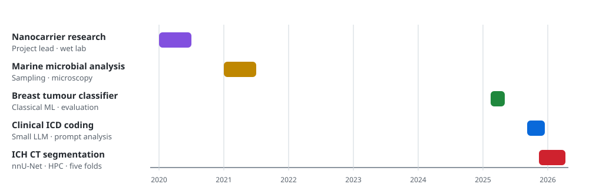

# 杨林鹏｜医疗 AI 与健康数据科学作品集

健康数据科学硕士，方向为医学影像、临床 NLP、机器学习评估和可复现研究。
我擅长把研究问题转化为可追踪的完整流程：数据审查、模型设计、受控实验、
误差分析以及有证据边界的结果表达。

[English](README.md)

## 个人概览

- **求职方向：** AI 算法工程师 · 医疗 AI · 大模型应用
- **核心技术：** Python · PyTorch · scikit-learn · Transformers · nnU-Net
- **研究环境：** Jupyter · Git · Linux · NCI Gadi · PBS
- **方法优势：** 实验设计 · 交叉验证 · 误差分析 · 可复现报告

## 项目时间线

## 代表项目

| 项目 | 使用的数据集 | 完整工作流程 | 代表结果 |
|---|---|---|---|
| [脑出血 CT 多类别分割](projects/ich-segmentation.zh-CN.md) | **BHSD** 头颅 CT 数据集，192 例对齐病例 | 数据治理 → nnU-Net 预处理 → 2D/2.5D/3D 五折训练 → OOF 推理 → 配对与效率分析 | 3D 原生前景 Dice **0.307**，并完成准确性、召回率和计算成本权衡分析 |
| [小模型临床 ICD 编码](projects/icd-coding.zh-CN.md) | **Asclepius Synthetic Clinical Notes**，共 158,114 条；按作业要求选取 5 条开发和 10 条测试病例 | 数据筛选 → 五版 Prompt → 结构化解析 → 解码策略比较 → 独立错误分析 | Prompt 能约束格式，但无法弥补 Qwen2.5-0.5B 的 ICD-10-AM 知识缺口 |
| [乳腺肿瘤良恶性分类](projects/breast-tumour-classification.zh-CN.md) | 课程提供的 **FNA Breast Cancer Tumour Dataset**，580 条记录及 Wisconsin 风格形态学特征 | 数据审查 → 标签与重复项清洗 → 编码与标准化 → 分层划分 → GridSearchCV → 留出集评估 | 114 条测试记录准确率 **97.37%**，恶性召回率 **0.93** |
| [海水微生物丰度与环境因素分析](projects/marine-microbial-analysis.zh-CN.md) | 不同地点和时间采集的海水样本 | 采样 → 平板计数 → 荧光显微镜计数 → 方法比较 → 环境因素解释 | 建立了连接微生物丰度测量与采样条件的比较实验流程 |
| [微环境响应型海洋多糖纳米基因载体](projects/nanocarrier-research.zh-CN.md) | 项目产生的载体制备、细胞摄取、溶酶体逃逸、稳定性、生物安全和肿瘤抑制实验数据 | 项目规划 → 载体制备 → 体外验证 → 成像与安全性评估 → 团队汇报 | 负责项目统筹并整合多条湿实验验证链路 |

## 我的工作方式

## 代表结果

### 脑出血分割基准

| 方法 | 原生前景 Dice | 整例 wall time 中位数 | GPU 峰值显存 |
|---|---:|---:|---:|
| 2D nnU-Net | 0.2708 ± 0.0156 | 9.188 秒 | 2.706 GB |
| 标准三切片 2.5D | 0.2583 ± 0.0107 | 10.004 秒 | 2.771 GB |
| 3D full resolution | **0.3065 ± 0.0343** | 20.173 秒 | 7.994 GB |

3D 提高了原生 Dice 和假阳性控制，但需要更多时间与显存，并在召回率和小病灶
敏感性上存在权衡。所测试的三切片 2.5D 成本接近 2D，但没有形成稳定准确性优势。

### 乳腺肿瘤分类器

| 指标 | 测试集结果 |
|---|---:|
| 准确率 | **0.9737** |
| 恶性精确率 | **1.00** |
| 恶性召回率 | **0.93** |
| 恶性 F1 | **0.96** |

### 小模型 ICD 编码

在固定开发集上比较了五版 Prompt。最佳开发集准确率为 20%，最终 10 条独立
测试病例没有正确编码。这个负结果说明：输出格式约束无法替代模型缺失的
ICD-10-AM 专业知识。

## 技术矩阵

| 方向 | 工具与方法 |
|---|---|
| 医学影像 | nnU-Net v2、2D/2.5D/3D 分割、OOF 评估、病灶分析 |
| 经典机器学习 | pandas、NumPy、scikit-learn、逻辑回归、GridSearchCV |
| 临床 NLP | Hugging Face Transformers、Qwen2.5、Prompt 对比、结构化解析 |
| 评估方法 | 分层划分、交叉验证、Dice、精确率/召回率/F1、Bootstrap 分析 |
| 研究工程 | Git、Linux、PBS、NCI Gadi、实验清单、校验和验证 |
| 湿实验研究 | 显微镜、平板计数、纳米载体制备、细胞实验 |

## 教育经历

- **新南威尔士大学 健康数据科学硕士**，2024–2026
- **中国海洋大学 生物技术理学学士**，2017–2022

## 负责任的公开展示

作品集展示项目方法、聚合结果和可复现流程说明。个人识别信息、患者级内容、
临床原文、账户凭据、内部路径及未公开的原始记录均不进入公开页面。
