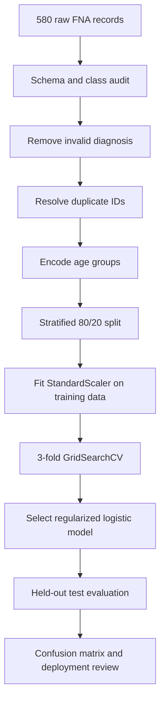
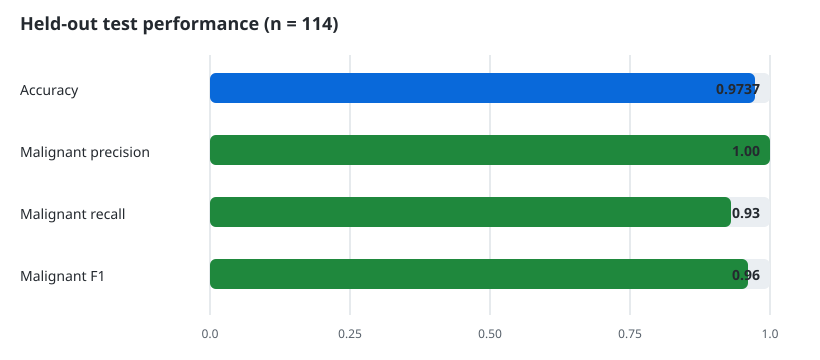
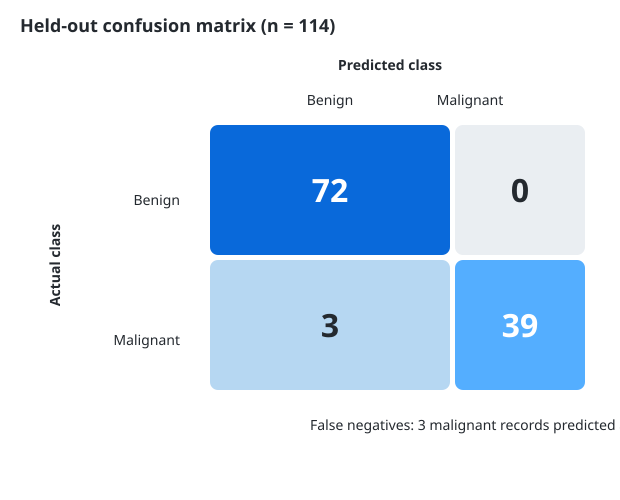

# Breast Tumour Classification

> Machine Learning I course project · February–March 2025 ·
> [中文](breast-tumour-classification.zh-CN.md)

## Project at a glance

| Item | Detail |
|---|---|
| Objective | Build an interpretable benign-versus-malignant classifier from FNA-derived tumour features |
| Dataset | Course-provided FNA Breast Cancer Tumour Dataset with Wisconsin-style morphology features |
| Raw data | 580 rows, 34 columns |
| Clean modelling data | 569 unique records, 35 encoded columns including target |
| Model | Regularized logistic regression |
| Validation | Stratified 80/20 split plus three-fold GridSearchCV on training data |
| Primary tuning metric | F1 score |

## End-to-end workflow



## 1. Data understanding

The table contained a record identifier, diagnosis, 30 continuous tumour
morphology measurements, an encoded age field, and a duplicate diagnosis
field. Morphology variables represented the mean, standard error, and worst
value of features such as radius, texture, perimeter, area, smoothness,
compactness, concavity, concave points, symmetry, and fractal dimension.

Initial class distribution:

| Label | Meaning | Count |
|---|---|---:|
| B | Benign | 364 |
| M | Malignant | 215 |
| X | Invalid label | 1 |

## 2. Data cleaning

The cleaning sequence was intentionally completed before modelling:

1. retained only valid `B` and `M` diagnosis values;
2. mapped malignant to 1 and benign to 0;
3. grouped duplicate identifiers and averaged numeric measurements;
4. resolved conflicting duplicate diagnoses conservatively, favouring
   malignant in a tie;
5. removed the record identifier after deduplication;
6. mapped the course-encoded age values to four age groups and one-hot encoded
   them.

This reduced 580 raw rows to **569 unique modelling records**:

| Clean label | Count | Share |
|---|---:|---:|
| Benign | 357 | 62.7% |
| Malignant | 212 | 37.3% |

## 3. Exploratory analysis

- Reviewed schema, data types, summary statistics, and class balance.
- Inspected the relationship between morphology variables using a correlation
  matrix.
- Identified groups of strongly correlated size-related features, which is
  expected because radius, perimeter, and area describe related geometry.
- Retained the variables for regularized logistic regression, allowing the
  penalty to control coefficient complexity rather than manually discarding
  correlated predictors.

## 4. Train–test design

The cleaned table was split with `random_state=30` and stratification on the
diagnosis label:

| Partition | Rows | Proportion |
|---|---:|---:|
| Training | 455 | 80% |
| Test | 114 | 20% |

`StandardScaler` was fitted only on the training predictors and then applied to
the test predictors. This kept test-set information out of preprocessing.

## 5. Hyperparameter tuning

The base estimator was `LogisticRegression(solver="liblinear", max_iter=500)`.
Three-fold grid search evaluated 40 combinations:

| Hyperparameter | Search space |
|---|---|
| Penalty | L1, L2 |
| Inverse regularization `C` | 0.01, 0.1, 1, 10, 100 |
| Class weight | `{malignant: 0.8, benign: 0.2}`, `{0.7, 0.3}`, `{0.6, 0.4}`, or none |
| Selection metric | F1 score |

Best cross-validation configuration:

```text
penalty = L2
C = 1
class_weight = {malignant: 0.6, benign: 0.4}
mean CV F1 = 0.9707
```

## 6. Held-out results



| Metric | Benign | Malignant | Overall / weighted |
|---|---:|---:|---:|
| Precision | 0.96 | **1.00** | 0.97 |
| Recall | **1.00** | 0.93 | 0.97 |
| F1 | 0.98 | 0.96 | 0.97 |
| Support | 72 | 42 | 114 |

- Training accuracy: **98.68%**
- Test accuracy: **97.37%**
- The small train–test gap suggested limited overfitting in this split.

## 7. Confusion matrix



| Actual \ Predicted | Benign | Malignant |
|---|---:|---:|
| Benign | **72** | 0 |
| Malignant | 3 | **39** |

There were no false-positive malignant predictions, while three malignant
records were predicted as benign. In a clinical screening context, these false
negatives are more consequential than ordinary classification errors, so the
0.93 malignant recall remains a central limitation even with high accuracy.

## 8. Interpretation and deployment considerations

**Strengths**

- transparent linear model with interpretable coefficients;
- strong held-out discrimination;
- regularization and class weighting were selected inside cross-validation;
- preprocessing used a train-only fit for the scaler.

**Limitations**

- evaluation used one course dataset and one held-out split;
- correlated predictors can make individual coefficients unstable;
- three malignant false negatives remained;
- the experiment did not include external or prospective validation,
  calibration analysis, or decision-curve analysis.

**Recommended next steps**

1. repeat nested or repeated stratified cross-validation;
2. report ROC-AUC and PR-AUC with confidence intervals;
3. assess probability calibration and clinically chosen thresholds;
4. validate on an independent dataset before any clinical use;
5. monitor sensitivity by demographic and acquisition subgroups.

## Tools demonstrated

Python · pandas · NumPy · seaborn · scikit-learn · StandardScaler · Logistic
Regression · GridSearchCV · stratified evaluation · confusion-matrix analysis

[Back to portfolio](../README.md)
