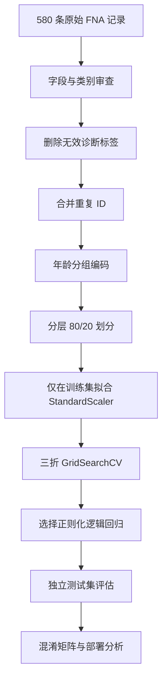
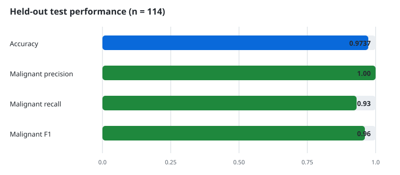
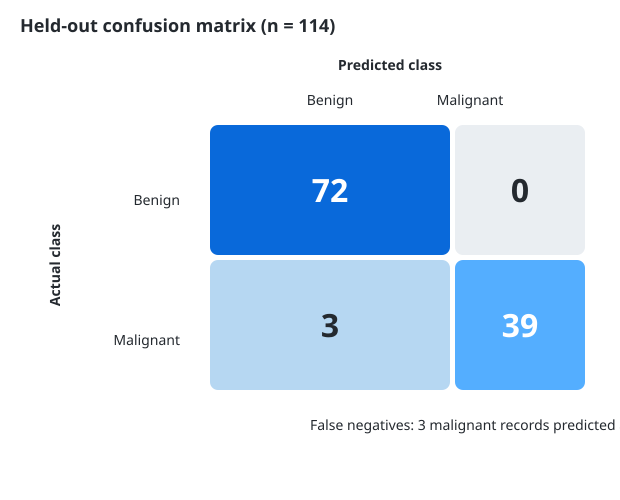

# 乳腺肿瘤良恶性分类

> Machine Learning I 课程项目 · 2025 年 2–3 月 ·
> [English](breast-tumour-classification.md)

## 项目概览

| 项目 | 内容 |
|---|---|
| 目标 | 基于 FNA 肿瘤特征构建可解释的良性/恶性二分类器 |
| 数据集 | 课程提供的 FNA Breast Cancer Tumour Dataset，包含 Wisconsin 风格形态学特征 |
| 原始数据 | 580 行、34 列 |
| 清洗后数据 | 569 条唯一记录，编码后含目标共 35 列 |
| 模型 | 正则化逻辑回归 |
| 验证 | 分层 80/20 划分；训练集内三折 GridSearchCV |
| 调参指标 | F1 |

## 完整流程

## 1. 数据理解与清洗

数据包含诊断标签、30 个连续形态学变量、年龄编码及重复诊断字段。形态学变量
覆盖半径、纹理、周长、面积、平滑度、紧致度、凹度、凹点、对称性和分形维数的
均值、标准误和最差值。

| 原始标签 | 含义 | 数量 |
|---|---|---:|
| B | 良性 | 364 |
| M | 恶性 | 215 |
| X | 无效标签 | 1 |

清洗步骤：

1. 仅保留 `B` 和 `M`；
2. 将恶性映射为 1、良性映射为 0；
3. 按 ID 合并重复记录并对数值变量取均值；
4. 重复记录诊断冲突时采用保守规则，平票时选择恶性；
5. 去除 ID；
6. 将课程编码的年龄值映射为四个年龄组并进行 One-hot 编码。

清洗后得到 357 条良性和 212 条恶性记录，共 **569 条**。

## 2. 探索性分析

- 审查字段、类型、描述统计和类别分布；
- 用相关矩阵分析形态学变量关系；
- 识别半径、周长和面积等尺寸变量之间的高相关性；
- 保留变量并使用正则化控制模型复杂度，而不是主观删除特征。

## 3. 数据划分与预处理

使用 `random_state=30`，按诊断标签分层：

| 数据部分 | 数量 | 比例 |
|---|---:|---:|
| 训练集 | 455 | 80% |
| 测试集 | 114 | 20% |

`StandardScaler` 只在训练特征上拟合，再应用到测试集，避免预处理泄漏。

## 4. 模型调参

基础模型为 `LogisticRegression(solver="liblinear", max_iter=500)`，三折网格搜索
比较 40 组组合：

| 参数 | 搜索范围 |
|---|---|
| penalty | L1、L2 |
| C | 0.01、0.1、1、10、100 |
| class weight | 三组恶性偏重方案或不加权 |
| 选择指标 | F1 |

最佳配置为 **L2、C=1、class_weight={恶性:0.6, 良性:0.4}**，平均验证 F1 为
**0.9707**。

## 5. 测试集结果

| 指标 | 良性 | 恶性 | 总体/加权 |
|---|---:|---:|---:|
| 精确率 | 0.96 | **1.00** | 0.97 |
| 召回率 | **1.00** | 0.93 | 0.97 |
| F1 | 0.98 | 0.96 | 0.97 |
| 样本数 | 72 | 42 | 114 |

- 训练准确率：**98.68%**
- 测试准确率：**97.37%**

| 实际 \ 预测 | 良性 | 恶性 |
|---|---:|---:|
| 良性 | **72** | 0 |
| 恶性 | 3 | **39** |

模型没有把良性误判为恶性，但有 3 条恶性记录被判为良性。在筛查场景中，假阴性
比普通错误更关键，因此即使总体准确率很高，0.93 的恶性召回率仍需重点改进。

## 6. 局限与下一步

- 当前结果来自一个课程数据集和一次留出划分；
- 需要重复或嵌套分层交叉验证；
- 应补充 ROC-AUC、PR-AUC、置信区间和概率校准；
- 应基于临床成本选择阈值，而不是默认 0.5；
- 临床使用前必须在独立外部数据上验证，并检查亚组敏感性。

技术栈：Python、pandas、NumPy、seaborn、scikit-learn、StandardScaler、
Logistic Regression、GridSearchCV、分层评估和混淆矩阵分析。

[返回作品集](../README.zh-CN.md)
