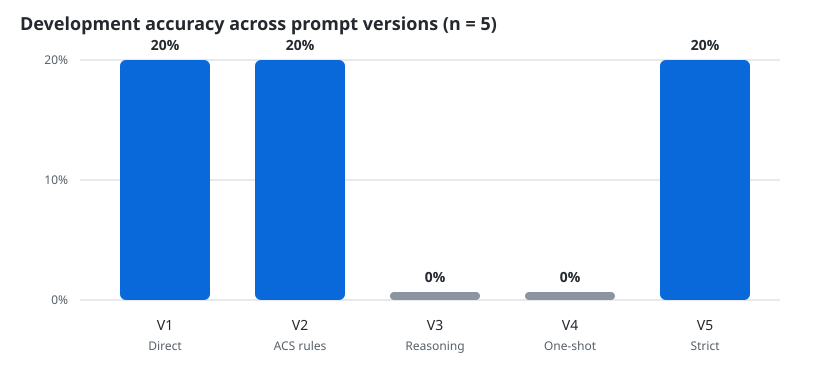
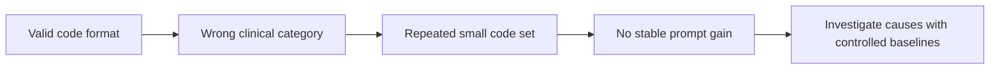

# Clinical ICD Coding with a Small Language Model

> Machine Learning II course project · September–December 2025 ·
> [中文](icd-coding.zh-CN.md)

## Project at a glance

| Item | Detail |
|---|---|
| Objective | Generate a three-character ICD-10-AM principal-diagnosis category from a synthetic hospital-course summary |
| Dataset | `starmpcc/Asclepius-Synthetic-Clinical-Notes` on Hugging Face |
| Dataset scale | 158,114 synthetic clinical-note records |
| Experiment subset | 5 fixed development cases and 10 independent test cases |
| Model | `Qwen/Qwen2.5-0.5B-Instruct` |
| Framework | PyTorch and Hugging Face Transformers |
| Output contract | Exactly one uppercase letter followed by two digits |

## End-to-end workflow


## 1. Dataset preparation

The Asclepius dataset contains synthetic clinical notes and related tasks. The
assignment specified a fixed subset so every prompt version was tested on the
same cases:

| Split | Cases | Purpose |
|---|---:|---|
| Development | 5 | Prompt design and decoding experiments |
| Independent test | 10 | Final evaluation after prompt selection |

Filtering was performed with Hugging Face `Dataset.filter`, followed by a
conversion to pandas for experiment tracking. The comparison retained the
same cases across all five prompt versions.

## 2. Model and generation pipeline

The tokenizer and causal language model were loaded from
`Qwen/Qwen2.5-0.5B-Instruct`. Each experiment used a chat-style system message
and user message, then applied the model's chat template before tokenization.

The default generation path used:

```text
max_new_tokens = 8
do_sample = False
decoding = deterministic greedy generation
post-processing = strip → first 3 characters → uppercase
```

Only newly generated tokens were decoded, preventing the prompt text from
being mistaken for the answer.

## 3. Prompt engineering experiments

| Version | Design change | Development accuracy |
|---|---|---:|
| V1 | Simple coder role and direct three-character output request | 20% |
| V2 | Added ACS 0001 definition, excluded symptoms/procedures, strict format | 20% |
| V3 | Added internal reasoning instruction and reinforced ACS rules | 0% |
| V4 | One-shot example before the target case | 0% |
| V5 | Certified-coder role, underlying-condition step, strict one-code contract | 20% |



The prompt iterations were controlled rather than cumulative guessing: each
version changed a specific instruction strategy while using the same
development cases and the same model.

## 4. Structured output handling

The experiment separated two questions:

1. **Can the model obey the output format?**
2. **Is the generated code clinically correct?**

This distinction matters because a syntactically valid code can still be the
wrong diagnosis category. Predictions were normalized to a three-character
category before exact comparison with the reference code.

## 5. Decoding-parameter experiment

Prompt V5 was also tested on three development cases with stochastic decoding:

```text
do_sample = True
temperature = 0.7
top_p = 0.9
```

Sampling changed the predicted categories but did not improve correctness. It
also made outputs less stable. Deterministic greedy decoding was therefore
retained for the final independent evaluation.

## 6. Independent test result

| Evaluation | Correct | Total | Accuracy |
|---|---:|---:|---:|
| Final test with Prompt V5 and greedy decoding | 0 | 10 | 0% |

The result is a useful negative finding rather than a deployment result. A
general 0.5B-parameter instruction model could follow portions of the output
contract, but prompting alone did not provide the specialist ICD-10-AM and ACS
knowledge needed for principal-diagnosis coding.

## 7. Error analysis

The analysis separates **what the experiment directly observed** from
**possible explanations**. This prevents a plausible cause from being reported
as if it had already been proven.

### What was directly observed

| Observation | Evidence | Supported conclusion |
|---|---|---|
| Valid-looking codes were still wrong | The model often returned a three-character string such as `G05`, but the final exact-match score was 0/10 | Following the output format did not imply correct clinical coding |
| Predictions concentrated on a small set of similar codes | Several different test notes received repeated `G04`, `G05`, or `G06`-type outputs, while the reference categories spanned multiple ICD chapters | The model did not adequately distinguish the diagnostic content of the cases |
| More detailed prompts did not improve accuracy | V1, V2, and V5 each scored 1/5; V3 and V4 scored 0/5 on the fixed development set | Additional rules, implicit reasoning, and one-shot prompting did not produce a stable gain |
| Sampling changed answers but not correctness | `temperature=0.7` and `top_p=0.9` produced different codes without improving the tested cases | Randomness increased output variability rather than solving the mapping problem |

The central error pattern was therefore **valid format, incorrect meaning**.
The model learned what an ICD category looks like, but it did not reliably map
the hospital-course information to the correct category.



### Possible causes — not proven by this experiment

| Hypothesis | Why it is plausible | How to test it |
|---|---|---|
| Insufficient ICD-10-AM and ACS knowledge | The 0.5B general instruction model was not trained specifically for Australian clinical coding | Compare zero-shot generation with RAG using an ICD/ACS knowledge base |
| Model capacity limitation | Mapping a long clinical narrative to one principal diagnosis requires summarisation, rule application, and code selection | Run the same locked cases with larger models under the same prompt and decoding protocol |
| Prompt or example sensitivity | Prompt versions changed predictions, but none improved reliably | Repeat with several balanced examples and multiple prompt-order controls |
| Free-generation mismatch | The task has a fixed label space, while the model generated a code from unrestricted text | Compare free generation with constrained candidate retrieval and ranking |

These are hypotheses for follow-up experiments. The current results demonstrate
unreliable coding performance, but they do not isolate one definitive cause.

## 8. Improvement plan

1. **Retrieval-augmented generation:** retrieve relevant ICD-10-AM categories
   and ACS guidance before generation.
2. **Supervised fine-tuning:** train on note-to-principal-code examples with
   balanced diagnostic families.
3. **Constrained candidate ranking:** generate or retrieve a small candidate
   set, then rank codes instead of free-form generation.
4. **Deterministic validation:** reject outputs that fail the category regex or
   do not exist in the code dictionary.
5. **Stronger evaluation:** use a larger locked test set, top-k accuracy,
   category-level confusion analysis, and confidence calibration.
6. **Human oversight:** retain qualified clinical coders for review; the model
   should support, not autonomously replace, coding decisions.

## Tools demonstrated

Python · PyTorch · Hugging Face Datasets · Transformers · Qwen2.5 · chat
templates · prompt ablation · decoding analysis · structured parsing · exact
match evaluation · clinical NLP error analysis

[Back to portfolio](../README.md)
