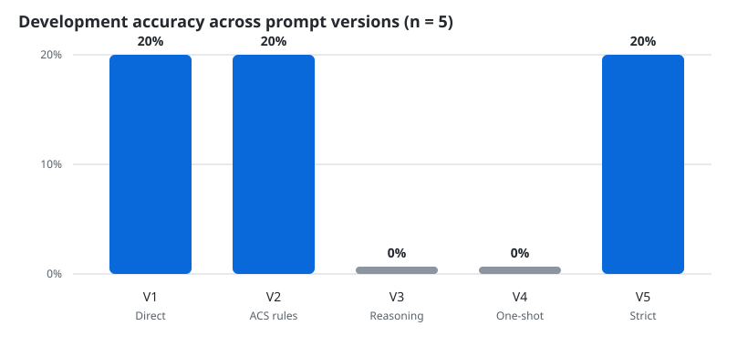
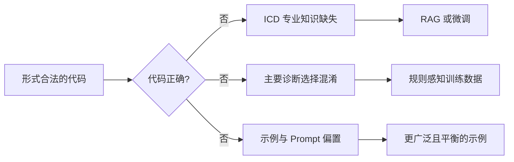

# 小模型临床 ICD 编码

> Machine Learning II 课程项目 · 2025 年 9–12 月 ·
> [English](icd-coding.md)

## 项目概览

| 项目 | 内容 |
|---|---|
| 目标 | 根据合成住院病程生成三字符 ICD-10-AM 主要诊断类别 |
| 数据集 | Hugging Face `starmpcc/Asclepius-Synthetic-Clinical-Notes` |
| 数据规模 | 158,114 条合成临床记录 |
| 实验子集 | 5 条固定开发病例、10 条独立测试病例 |
| 模型 | `Qwen/Qwen2.5-0.5B-Instruct` |
| 框架 | PyTorch、Hugging Face Transformers |
| 输出约束 | 一个大写字母加两位数字 |

## 完整流程


## 1. 数据与实验划分

Asclepius 数据集包含合成临床文本和多种任务。作业指定固定病例，保证所有 Prompt
版本都在相同开发集上比较，最终再使用独立测试集。

| 划分 | 病例数 | 用途 |
|---|---:|---|
| 开发集 | 5 | Prompt 设计与解码实验 |
| 独立测试集 | 10 | 选定方案后的最终评估 |

使用 Hugging Face `Dataset.filter` 完成筛选，再转换为 pandas DataFrame 管理实验结果。

## 2. 模型与生成流程

加载 Qwen2.5-0.5B-Instruct 的 tokenizer 和 causal language model。每次实验构建
system/user 消息，应用模型 chat template 后分词，并仅解码新增 token。

默认生成配置：

```text
max_new_tokens = 8
do_sample = False
解码策略 = deterministic greedy
后处理 = strip → 前 3 个字符 → uppercase
```

## 3. 五版 Prompt 对比

| 版本 | 主要变化 | 开发集准确率 |
|---|---|---:|
| V1 | 基础编码员角色与直接三字符输出 | 20% |
| V2 | 加入 ACS 0001 定义、排除症状/操作、严格格式 | 20% |
| V3 | 加入内部推理指令并强化 ACS 规则 | 0% |
| V4 | 提供一条 One-shot 示例 | 0% |
| V5 | 强化专业角色、先识别基础疾病、只输出一个代码 | 20% |



每个版本只改变明确的指令策略，模型、病例和生成框架保持一致，因此可以把差异
更清楚地归因于 Prompt 设计。

## 4. 结构化输出与解码实验

实验把“格式是否正确”和“代码是否正确”分开，因为看起来合法的三字符代码仍可能
对应错误诊断。预测统一清洗为三字符类别，再与参考代码精确匹配。

另外在 3 条开发病例上比较随机采样：

```text
do_sample = True
temperature = 0.7
top_p = 0.9
```

采样改变了输出类别，但没有提高正确率，且降低稳定性，因此最终测试保留 greedy
解码。

## 5. 独立测试结果

| 评估 | 正确 | 总数 | 准确率 |
|---|---:|---:|---:|
| Prompt V5 + greedy 最终测试 | 0 | 10 | 0% |

这是一个有价值的负结果：0.5B 通用指令模型能够部分遵守输出形式，但仅靠 Prompt
无法补足 ICD-10-AM、ACS 和主要诊断选择所需的专业知识。

## 6. 错误分析



主要失败模式包括：模型重复生成熟悉的代码族、One-shot 示例对输出类别产生偏置，
以及更长的推理指令无法替代缺失的编码知识。

## 7. 改进路线

1. 检索相关 ICD-10-AM 类别和 ACS 规则后再生成；
2. 使用平衡诊断类别的 note-to-code 数据监督微调；
3. 从自由生成改为候选类别检索与排序；
4. 使用正则表达式和代码词典进行确定性校验；
5. 扩大锁定测试集，报告 Top-k、类别混淆和置信度校准；
6. 保留专业临床编码员审核，不把模型作为自动决策系统。

技术栈：Python、PyTorch、Hugging Face Datasets、Transformers、Qwen2.5、
Prompt 消融、解码分析、结构化解析、Exact-match 评估和临床 NLP 错误分析。

[返回作品集](../README.zh-CN.md)
