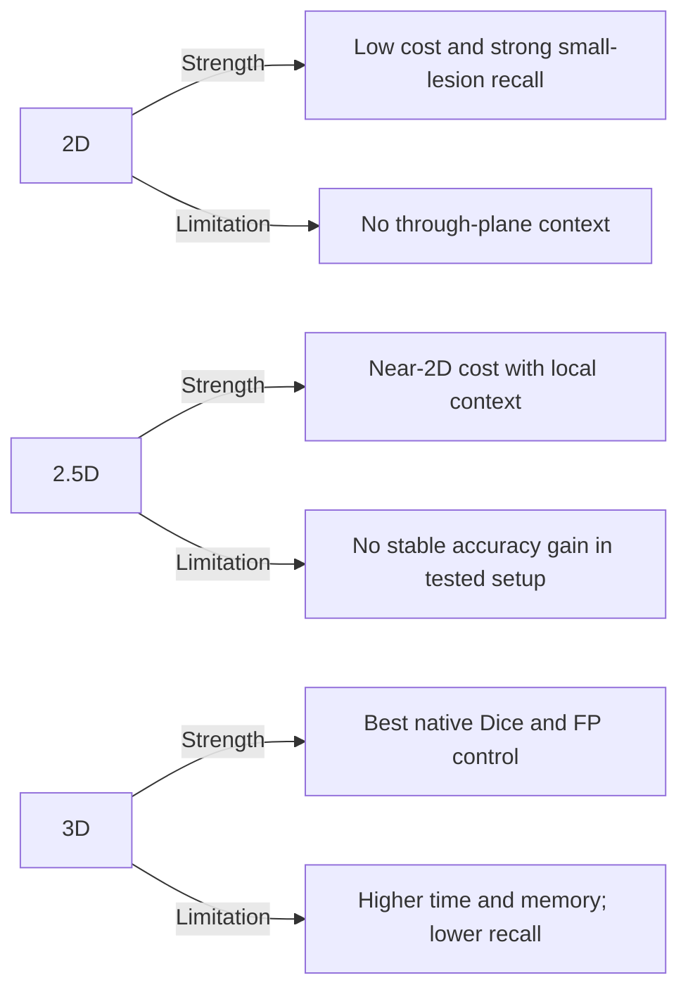

# Intracranial Haemorrhage CT Segmentation

> MSc research project · November 2025–August 2026 ·
> [中文](ich-segmentation.zh-CN.md)

## Project at a glance

| Item | Detail |
|---|---|
| Research question | How do 2D, standard three-slice 2.5D, and 3D nnU-Net differ in multiclass ICH segmentation accuracy, lesion detection, and compute cost? |
| Dataset | BHSD head CT dataset |
| Cohort | 192 patient-aligned cases per method |
| Target | Five-class intracranial haemorrhage segmentation |
| Validation | Five-fold out-of-fold evaluation with identical patient membership and folds |
| Scale | 576 model-case OOF masks and 2,880 patient-class rows |
| Infrastructure | Python, PyTorch, nnU-Net v2, NCI Gadi, PBS, Tesla V100-SXM2-32GB |

## End-to-end workflow

## 1. Dataset and task definition

The project used BHSD head CT volumes with multiclass haemorrhage annotations.
The evaluation inventory was aligned at the patient level before comparison so
that every method used the same 192 cases and the same five-fold assignments.
This avoided comparing models on different patient mixtures.

The task was not reduced to a single foreground-versus-background score. The
workflow retained multiclass predictions and separated three estimands:

- **native fold Dice** for the nnU-Net validation summary;
- **pooled OOF metrics** across all out-of-fold predictions;
- **patient-paired GT-present Dice** for class-balanced paired comparisons.

These values answer different questions and were not treated as
interchangeable.

## 2. Model configurations

| Configuration | Input context | Main purpose |
|---|---|---|
| 2D nnU-Net | One axial slice | Strong low-cost baseline for anisotropic CT |
| Standard three-slice 2.5D | Previous, centre, and next axial slices | Test whether limited through-plane context improves the 2D baseline |
| 3D full resolution | Volumetric patch | Learn full three-dimensional context at higher compute cost |

The 2.5D implementation expanded the input channel dimension while keeping the
2D segmentation target. Boundary slices used controlled neighbour handling so
that every centre slice retained a consistent input shape.

## 3. Training and experiment control

- Used five training folds for each of the three methods: **15 method-fold
  training tasks** in the primary multiclass benchmark.
- Kept patient membership and fold definitions fixed across methods.
- Used PBS job scripts and explicit environment configuration on NCI Gadi.
- Audited checkpoints, validation summaries, prediction inventories, and
  experiment manifests before aggregation.
- Separated completed evidence from exploratory or stopped experiments.

## 4. Out-of-fold inference and quality checks

Each patient was inferred only by the fold model that did not train on that
patient. Prediction and reference inventories were reconciled before metric
calculation. The sealed multiclass evidence package passed **41/41 automated
checks**, and **94/94 manifest SHA-256 entries** were verified.

## 5. Primary segmentation result

| Method | Five-fold native foreground Dice |
|---|---:|
| 2D | 0.270792 ± 0.015635 |
| Standard three-slice 2.5D | 0.258270 ± 0.010720 |
| 3D full resolution | **0.306509 ± 0.034337** |

The tested three-slice 2.5D setup did not show a stable advantage over 2D.
The 3D model led native Dice, lesion precision/F1, and absent-class
false-positive control. However, all patient-paired GT-present Dice bootstrap
intervals crossed zero, so the study did not establish a stable patient-level
overall winner.

## 6. Lesion-level and z-span analysis

Lesion recall was examined by ground-truth slice span to understand which
lesions were missed rather than relying on one global Dice score.

| Method | 1 slice | 2 slices | 3–4 slices | ≥5 slices |
|---|---:|---:|---:|---:|
| 2D | **0.274** | **0.646** | 0.838 | 0.942 |
| Standard three-slice 2.5D | 0.262 | 0.623 | **0.845** | **0.945** |
| 3D full resolution | 0.213 | 0.536 | 0.776 | 0.893 |

The z-span analysis covered 1,951 lesions and was treated as exploratory. Every
2.5D-minus-2D interval crossed zero; therefore, it describes heterogeneous
errors but does not prove that neighbouring slices caused an improvement.

## 7. Same-hardware efficiency audit

| Method | Wall median [IQR], s | GPU median, s | Cases/wall-hour | Peak allocated, GB | Parameters |
|---|---:|---:|---:|---:|---:|
| 2D | 9.188 [8.492, 10.729] | 8.171 | **334.6** | 2.706 | 46,332,650 |
| Three-slice 2.5D | 10.004 [8.952, 11.312] | 9.082 | 316.0 | 2.771 | 46,333,226 |
| 3D full resolution | 20.173 [19.594, 21.106] | 12.677 | 169.3 | 7.994 | 44,581,860 |

All methods were measured under the same V100, FP32, and
`torch.compile=false` protocol. The audit included 3,000 synchronized patch
timings and 576 whole-case timing records. FLOP coverage was incomplete, so an
unavailable 3D FLOP value was never encoded as zero.

## 8. Interpretation

The main conclusion is a trade-off, not a universal ranking. Under this BHSD
protocol, standard three-slice 2.5D did not stably outperform 2D. The 3D model
improved several precision-oriented endpoints while sacrificing recall,
small-lesion sensitivity, and compute efficiency.

## My contribution

- Designed and maintained the patient-aligned five-fold comparison.
- Implemented and validated the standard three-slice 2.5D extension.
- Managed preprocessing, training, inference, and audits on Gadi/PBS.
- Built aggregate metric, lesion, paired, and efficiency analyses.
- Documented evidence status so incomplete work could not be mistaken for a
  confirmed result.

## Repository and reproducibility

The full public code, configuration, result register, and aggregate figures are
available at [Kandasorat/bhsd-nnunet](https://github.com/Kandasorat/bhsd-nnunet).

[Back to portfolio](../README.md)
