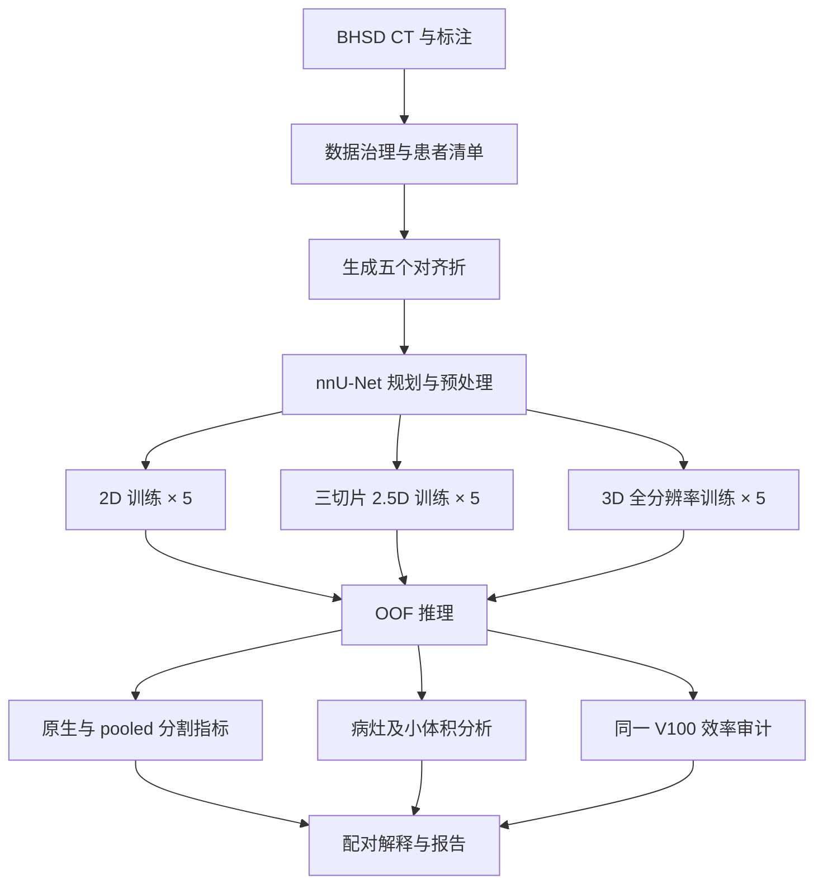
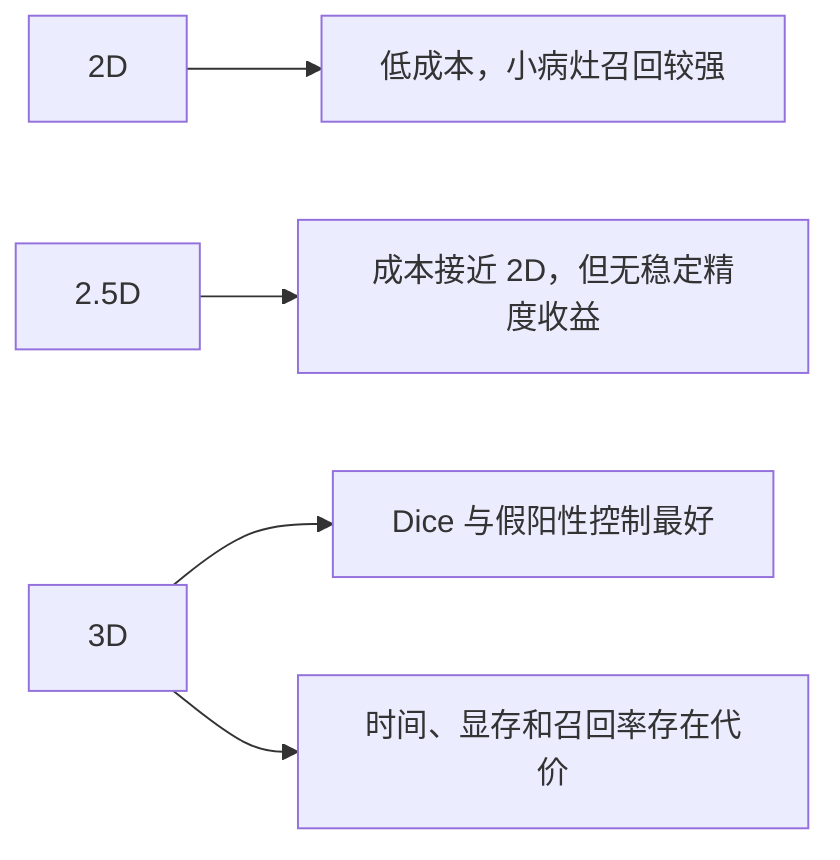

# 脑出血 CT 多类别分割

> 硕士研究项目 · 2025 年 11 月–2026 年 8 月 ·
> [English](ich-segmentation.md)

## 项目概览

| 项目 | 内容 |
|---|---|
| 研究问题 | 2D、标准三切片 2.5D 和 3D nnU-Net 在多类别脑出血分割准确性、病灶检出和计算成本上有何差异？ |
| 数据集 | BHSD 头颅 CT 数据集 |
| 队列 | 每种方法使用相同的 192 例病例 |
| 任务 | 五类脑出血分割 |
| 验证 | 患者对齐的五折 OOF 评估 |
| 规模 | 576 份模型–病例 OOF 掩膜，2,880 条患者–类别记录 |
| 计算环境 | Python、PyTorch、nnU-Net v2、NCI Gadi、PBS、Tesla V100 |

## 完整流程

## 1. 数据与任务定义

项目使用 BHSD 头颅 CT 及多类别出血标注。比较前先在患者层面对清单和五折分配
进行对齐，保证三种方法使用完全相同的 192 例病例，避免由患者构成差异造成偏差。

评估没有把所有结果压缩成一个 Dice，而是区分：

- nnU-Net 验证摘要使用的 **native fold Dice**；
- 汇总全部 OOF 预测的 **pooled OOF 指标**；
- 仅在 GT 存在时进行的 **患者配对、类别平衡 Dice**。

## 2. 模型设计

| 方法 | 输入上下文 | 设计目的 |
|---|---|---|
| 2D nnU-Net | 单张轴向切片 | 适合各向异性 CT 的低成本基线 |
| 标准三切片 2.5D | 前一张、中心张、后一张切片 | 检验局部层间信息能否改善 2D 基线 |
| 3D full resolution | 三维 patch | 以更高计算成本学习完整三维上下文 |

2.5D 实现扩大输入通道，但仍以中心切片作为分割目标；边界切片采用受控邻层处理，
保证所有输入形状一致。

## 3. 训练与质量控制

- 三种方法各训练五折，共 **15 个方法–折任务**；
- 固定患者成员和折分配；
- 使用 Gadi PBS 脚本和显式环境配置；
- 训练后核对 checkpoint、验证摘要、预测清单和实验 manifest；
- 将已完成结果、探索性分析和停止的实验明确分开。

每个患者仅由没有见过该患者的折模型进行推理。封存的多类别证据包通过
**41/41 项自动检查**，且 **94/94 个 SHA-256 条目**验证一致。

## 4. 主要结果

| 方法 | 五折原生前景 Dice |
|---|---:|
| 2D | 0.270792 ± 0.015635 |
| 标准三切片 2.5D | 0.258270 ± 0.010720 |
| 3D full resolution | **0.306509 ± 0.034337** |

所测试的三切片 2.5D 没有形成相对 2D 的稳定优势。3D 的原生 Dice、病灶精确率/
F1 和 GT 缺失类别假阳性控制更好，但患者配对 GT-present Dice 的三个 Bootstrap
区间均跨过 0，因此不能宣称存在稳定的患者层面总赢家。

## 5. 病灶层面分析

| 方法 | 1 层 | 2 层 | 3–4 层 | ≥5 层 |
|---|---:|---:|---:|---:|
| 2D | **0.274** | **0.646** | 0.838 | 0.942 |
| 三切片 2.5D | 0.262 | 0.623 | **0.845** | **0.945** |
| 3D full resolution | 0.213 | 0.536 | 0.776 | 0.893 |

z-span 分析覆盖 1,951 个病灶，只用于描述误差异质性。所有 2.5D–2D 区间均跨过
0，因此不能把结果解释为邻层信息带来的因果收益。

## 6. 同硬件效率分析

| 方法 | Wall 中位数 [IQR] | GPU 中位数 | 每 wall-hour 病例数 | 峰值显存 |
|---|---:|---:|---:|---:|
| 2D | 9.188 [8.492, 10.729] 秒 | 8.171 秒 | **334.6** | 2.706 GB |
| 三切片 2.5D | 10.004 [8.952, 11.312] 秒 | 9.082 秒 | 316.0 | 2.771 GB |
| 3D full resolution | 20.173 [19.594, 21.106] 秒 | 12.677 秒 | 169.3 | 7.994 GB |

三种方法均在相同 V100、FP32、`torch.compile=false` 协议下测量。审计包含
3,000 条同步 patch 计时和 576 条整例记录。

## 7. 结论与贡献

我的工作包括患者对齐实验设计、2.5D 扩展实现、Gadi/PBS 训练与推理、结果清单
审计、病灶与配对分析、效率测量，以及对证据状态和结论边界的公开文档化。

完整代码与聚合结果：[Kandasorat/bhsd-nnunet](https://github.com/Kandasorat/bhsd-nnunet)

[返回作品集](../README.zh-CN.md)
