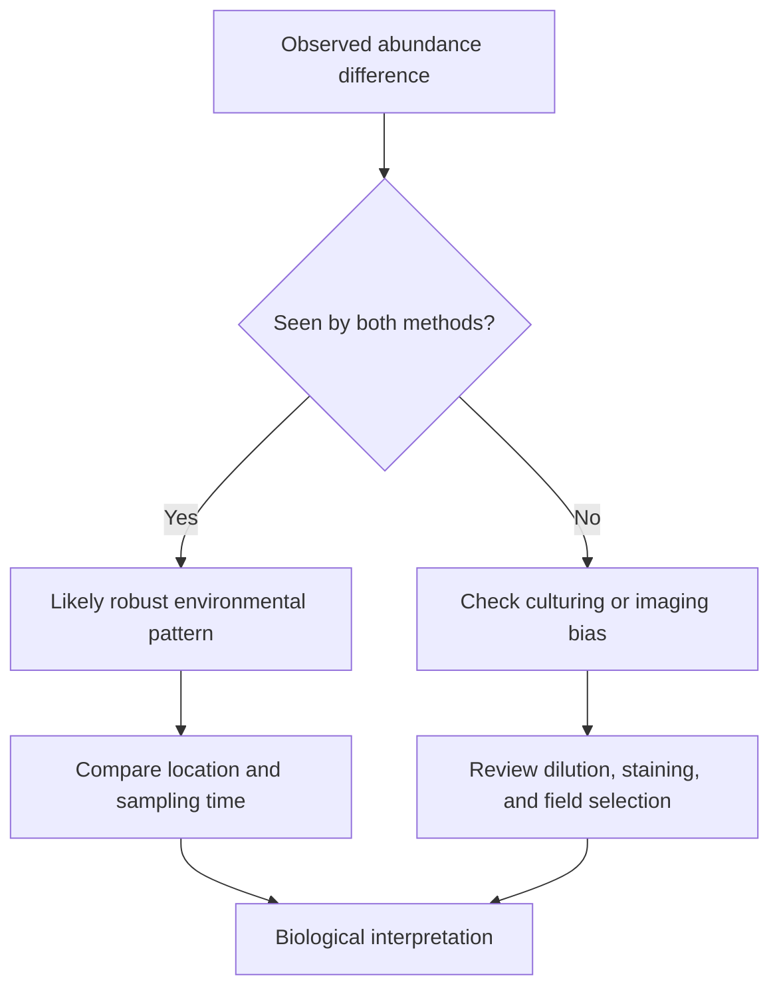

# Marine Microbial Abundance and Environmental Analysis

> Undergraduate research project · January–May 2021 ·
> [中文](marine-microbial-analysis.zh-CN.md)

## Project at a glance

| Item | Detail |
|---|---|
| Question | How does microbial abundance vary across seawater sampling locations and times, and how consistent are two measurement methods? |
| Dataset | Field-collected seawater samples with sampling metadata and project-generated microbial counts |
| Methods | Plate counting and fluorescence microscopy |
| Outputs | Comparative abundance analysis, environmental interpretation, and research report |

## Experimental workflow

## 1. Study design

Sampling time and location were treated as explicit experimental factors. A
consistent sample inventory linked every laboratory measurement to its source
condition, allowing method results and environmental variation to be compared
without losing provenance.

## 2. Plate-count workflow

1. prepared culture media and serial sample dilutions;
2. inoculated plates under controlled conditions;
3. selected countable plates and recorded colony counts;
4. converted counts to comparable abundance estimates using dilution and
   plated-volume information;
5. documented plates that were overgrown, sparse, or otherwise unsuitable.

## 3. Fluorescence-microscopy workflow

1. prepared and stained seawater subsamples;
2. captured multiple fields of view using consistent microscopy settings;
3. counted fluorescent microbial cells across replicate fields;
4. converted field counts to sample-level abundance estimates;
5. recorded image and counting quality observations.

## 4. Comparative analysis

The two methods measure related but non-identical biological quantities.
Culture-based counts reflect organisms able to grow under the selected
conditions, whereas microscopy can include visible cells that are not
culturable on the chosen medium.

| Comparison dimension | Plate counting | Fluorescence microscopy |
|---|---|---|
| Biological signal | Culturable colonies | Fluorescently visible cells |
| Main strengths | Low-cost and directly culture based | Faster view of total visible abundance |
| Main limitations | Medium and incubation bias | Staining, imaging, and manual-count variability |
| Quality controls | Countable range, dilution records | Replicate fields, consistent exposure and focus |

## 5. Interpretation framework

## My contribution

- collected and organized seawater samples and metadata;
- performed plate counting and fluorescence-microscopy measurements;
- aligned results from both methods into a comparable analysis structure;
- evaluated variation across sampling conditions;
- consolidated the experimental process and findings into the final report.

## Skills demonstrated

Experimental design · environmental sampling · sample provenance · plate
counting · fluorescence microscopy · comparative analysis · quality control ·
scientific reporting

[Back to portfolio](../README.md)
