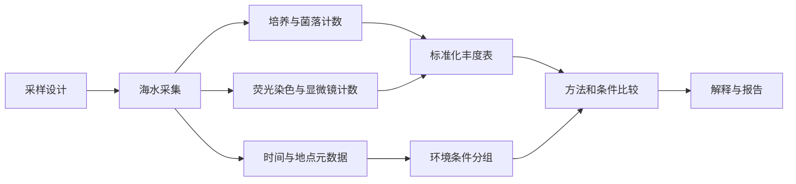

# 海水微生物丰度与环境因素分析

> 本科研究项目 · 2021 年 1–5 月 ·
> [English](marine-microbial-analysis.md)

## 项目概览

| 项目 | 内容 |
|---|---|
| 研究问题 | 不同采样地点和时间的微生物丰度如何变化，两种测量方法是否一致？ |
| 数据集 | 实地采集海水样本、采样元数据及项目产生的微生物计数 |
| 方法 | 平板计数、荧光显微镜计数 |
| 输出 | 丰度比较、环境因素解释和研究报告 |

## 实验流程

## 主要过程

采样时间和地点被作为明确实验因素，每项实验测量都与原始样本条件关联。平板计数
流程包括梯度稀释、接种、选择可计数平板以及按稀释倍数换算丰度；荧光显微镜流程
包括染色、多个视野成像、重复计数和样本级换算。

| 比较维度 | 平板计数 | 荧光显微镜 |
|---|---|---|
| 生物信号 | 可培养菌落 | 可见荧光细胞 |
| 优势 | 成本低、直接反映培养结果 | 更快观察总可见丰度 |
| 局限 | 培养基和培养条件偏差 | 染色、成像和人工计数变异 |
| 质控 | 可计数范围、稀释记录 | 重复视野、统一曝光与对焦 |

当两种方法都显示相似趋势时，环境差异更可信；当结果不一致时，需要回查稀释、
培养条件、染色效率和视野选择，而不能直接归因于环境因素。

我的工作包括海水样本与元数据整理、两种方法的实验测量、结果对齐、条件间比较
以及最终研究报告撰写。

[返回作品集](../README.zh-CN.md)
