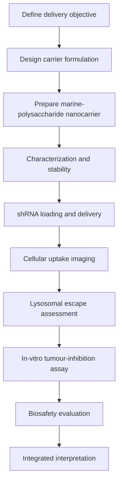
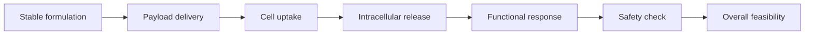

# Stimuli-Responsive Marine-Polysaccharide Nanocarrier

> Undergraduate innovation project · January–June 2020 · Project lead ·
> [中文](nanocarrier-research.zh-CN.md)

## Project at a glance

| Item | Detail |
|---|---|
| Goal | Explore a tumour-microenvironment-responsive marine-polysaccharide carrier for shRNA delivery |
| Dataset | Project-generated formulation, cell uptake, lysosomal escape, stability, biosafety, and in-vitro tumour-inhibition assay data |
| Role | Project lead: planning, task allocation, experimental coordination, selected wet-lab work, and reporting |
| Research style | Multi-stage formulation and in-vitro validation |

## Research workflow

## 1. Project planning

As project lead, I translated the overall research question into experimental
modules, allocated responsibilities, tracked dependencies between preparation
and cell experiments, and coordinated the consolidation of results. The
workflow was staged so that later biological tests depended on acceptable
formulation and stability observations.

## 2. Carrier preparation and characterization

- prepared marine-polysaccharide-based carrier formulations;
- recorded preparation conditions and batch information;
- assessed formulation stability over the planned observation period;
- compared batches before progressing to cell experiments.

## 3. Delivery and cellular behaviour

The biological validation sequence examined whether the system could move from
material preparation to intracellular delivery:

| Validation stage | Question addressed |
|---|---|
| shRNA loading/delivery | Can the carrier transport the intended genetic payload? |
| Cellular uptake | Does the formulation enter target cells? |
| Lysosomal escape | Can the payload move beyond endosomal/lysosomal confinement? |
| Tumour-inhibition assay | Is there an observable in-vitro functional effect? |
| Biosafety | Is the formulation acceptably tolerated under test conditions? |

Fluorescence imaging was used to observe uptake and intracellular localisation,
while cell assays connected delivery behaviour with functional and safety
outcomes.

## 4. Evidence integration

The project was interpreted as a chain of dependent evidence. A positive
downstream result could not compensate for an unstable formulation, and an
uptake image alone could not establish functional delivery or biosafety.

## My contribution

- led planning, task allocation, and progress tracking;
- participated in carrier preparation and shRNA delivery experiments;
- supported fluorescence-imaging evaluation of uptake and lysosomal escape;
- contributed to in-vitro tumour-inhibition, stability, and biosafety tests;
- integrated experimental observations into the team report.

## Skills demonstrated

Project leadership · experimental planning · nanocarrier formulation · cell
culture workflow · fluorescence imaging · stability assessment · biosafety
testing · multi-stream evidence integration · scientific communication

[Back to portfolio](../README.md)
