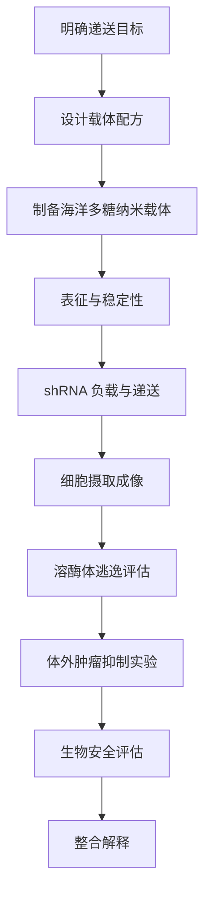

# 微环境响应型海洋多糖纳米基因载体

> 本科创新项目 · 2020 年 1–6 月 · 项目负责人 ·
> [English](nanocarrier-research.md)

## 项目概览

| 项目 | 内容 |
|---|---|
| 目标 | 探索用于 shRNA 递送的肿瘤微环境响应型海洋多糖载体 |
| 数据集 | 项目产生的配方、细胞摄取、溶酶体逃逸、稳定性、生物安全和体外肿瘤抑制实验数据 |
| 角色 | 项目规划、任务分配、实验协调、部分湿实验及结果汇报 |
| 研究方式 | 多阶段材料制备与体外验证 |

## 研究流程

## 项目过程

作为负责人，我把总体问题拆分为配方制备、稳定性、递送、细胞行为、功能效果和
安全性模块，协调各模块的前后依赖。后续细胞实验只有在配方和稳定性达到可继续
测试的条件后才进入下一阶段。

| 验证阶段 | 对应问题 |
|---|---|
| shRNA 负载与递送 | 载体能否运输目标遗传载荷？ |
| 细胞摄取 | 配方是否进入目标细胞？ |
| 溶酶体逃逸 | 载荷能否脱离内体/溶酶体限制？ |
| 肿瘤抑制实验 | 是否产生可观察的体外功能效果？ |
| 生物安全 | 测试条件下是否具有可接受耐受性？ |

荧光成像用于观察摄取和细胞内定位，细胞实验将递送行为与功能效果、安全结果连接。
整条证据链按“稳定配方 → 载荷递送 → 细胞摄取 → 细胞内释放 → 功能响应 →
安全检查”解释，单一摄取图像不能替代功能和安全证据。

我的工作包括项目规划、任务分配、载体制备、shRNA 递送、摄取与溶酶体逃逸成像、
体外肿瘤抑制、稳定性和生物安全实验，以及团队结果整合。

[返回作品集](../README.zh-CN.md)
